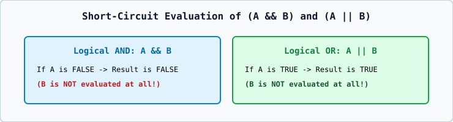

# 01 — Arithmetic, Relational, and Short-Circuit Logical Operators

## 1. Integer Division vs. Floating-Point Division
- When **both** operands of `/` are integers (`7 / 2`), C++ performs **integer division**, truncating toward zero (`3`).
- The remainder operator `%` works **only** on integer types (`7 % 2 == 1`).

## 2. Short-Circuit Evaluation of `&&` and `||`
Unlike `+` or `*`, the built-in logical `&&` and `||` operators guarantee strict **Left-to-Right** evaluation with **short-circuiting**:
- In `expr1 && expr2`: If `expr1` evaluates to `false`, `expr2` is **not evaluated at all**! (This makes `if (p != nullptr && *p == 10)` completely safe!).
- In `expr1 || expr2`: If `expr1` evaluates to `true`, `expr2` is **not evaluated at all**!
