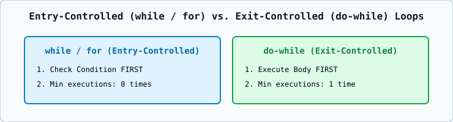

# 02 — Loops: `for`, `while`, `do-while`, and Range-Based `for`

1. **`while` Loop (Entry-Controlled)**: Evaluates condition **before** executing the body (`0` or more iterations).
2. **`do-while` Loop (Exit-Controlled)**: Executes the body **at least once** before checking the condition at the bottom (`do { ... } while (cond);`).
3. **`for` Loop**: `for (init; condition; update) { ... }`.
4. **Range-Based `for` Loop (C++11–C++23)**: `for (int x : arr)` or `for (const auto& elem : container)`.
