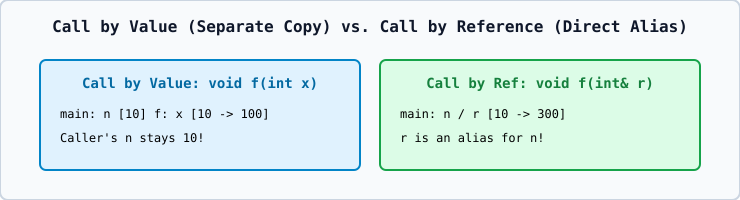

# 01 — Call by Value, Call by Address (Pointer), and Call by Reference

| Mechanism | Syntax | Copies Argument? | Can Modify Caller's Variable? |
| :--- | :--- | :---: | :---: |
| **Call by Value** | `void f(int x)` | **Yes** (independent local copy) | **No** |
| **Call by Address** | `void f(int* p)` | Copies pointer address (8 bytes) | **Yes** (via `*p = ...`) |
| **Call by Reference** | `void f(int& r)` | **No** (`r` aliases caller's variable) | **Yes** (via `r = ...`) |
| **Call by `const` Reference** | `void f(const string& s)` | **No** | **No** (Read-only, zero-copy) |
