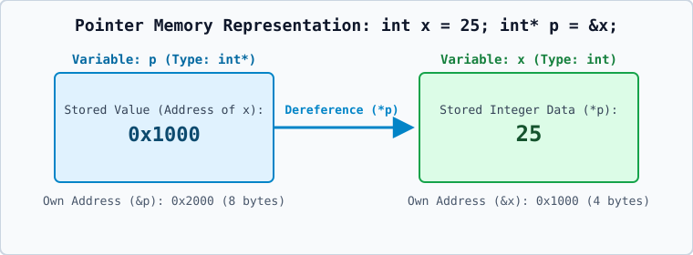
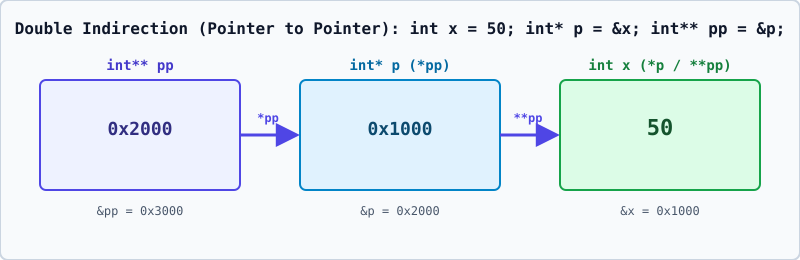

# 01 — Pointers: Fundamentals, Memory Model, and Indirection



---

## 1. Definition

A **pointer** is a strongly-typed variable that stores the **memory address** of another object or function rather than storing a direct data value.

## 2. Simple Explanation & Real-World Analogy

When you declare a normal integer variable:

```cpp
int x = 25;
```

The compiler reserves a block of memory (typically 4 bytes on modern 64-bit architectures), associates the name `x` with that block's starting byte address (for example, `0x1000`), and writes the binary representation of `25` inside it.

A **pointer** `p` is like an index card in a library catalog:
- The book (`x`) sits on a specific shelf (`0x1000`) and contains the actual text (`25`).
- The catalog card (`p`) sits in a catalog drawer (`0x2000`) and has `0x1000` written on it.
- **Reading `p`** tells you *where* the book is (`0x1000`).
- **Dereferencing `*p`** means walking to shelf `0x1000` and reading or changing the book itself (`25`).

## 3. Why Pointers Are Needed

1. **Indirect Modification Across Functions**: Passing the address of a variable allows a function to modify the caller's variable without copying large objects.
2. **Dynamic Memory Allocation**: Objects allocated on the free store (heap) via `new` have no variable name; they can only be accessed via their memory address stored in a pointer.
3. **Arrays and Strings**: Array indexing `arr[i]` is defined by the C++ standard as `*(arr + i)`.
4. **Data Structures**: Linked lists, trees, and graphs connect nodes in memory using pointers.
5. **Runtime Polymorphism**: Base-class pointers (`base*`) can point to derived-class objects (`derived`) to invoke `virtual` functions dynamically.

---

## 4. Core Operators: Address-of (`&`) and Dereference (`*`)

### A. The Address-of Operator (`&`)
- **Syntax**: `&variable_name`
- **Operand requirement**: Must be an **lvalue** (an object with an identifiable memory location). You cannot take the address of a literal (`&42` is a compilation error) or a temporary expression (`&(a + b)` is a compilation error).
- **Result**: Returns a pointer of type `T*` (if the operand has type `T`) containing the starting byte address of the operand.

### B. The Indirection / Dereference Operator (`*`)
- **Syntax**: `*pointer_name`
- **Operand requirement**: Must be a valid pointer of type `T*` (cannot be `void*`, cannot be `nullptr`, and must point to a live object).
- **Result**: Produces an **lvalue** referring to the actual object of type `T` located at the stored address.
  - On the **right side** of `=`: `int y = *p;` reads the value stored at that address.
  - On the **left side** of `=`: `*p = 99;` overwrites the value stored at that address.

---

## 5. Pointer Declaration and Initialization Syntax

```cpp
int x = 10;
int* p = &x;   // p is a pointer to int, initialized with the address of x
```

### Understanding Every Part of the Syntax
- `int*`: The type of `p` ("pointer to `int`"). Note that in `int *p, q;`, the `*` binds to the declarator `p`, so `p` is an `int*` while `q` is a normal `int`! Always declare one pointer per line to prevent confusion.
- `p`: The identifier of the pointer variable itself.
- `= &x`: Initializes `p` so that it holds the memory address of `x`.

###Why Pointers Have Types (`int*` vs `double*`)
Even though every data pointer on a 64-bit machine occupies **8 bytes** (because all 64-bit memory addresses are 8 bytes wide), the compiler must know the pointed-to type `T` for two critical reasons:
1. **Dereferencing (`*p`)**: How many bytes to read from memory (`1` byte for `char`, `4` bytes for `int`, `8` bytes for `double`) and how to interpret the bits (two's complement integer vs. IEEE-754 floating-point).
2. **Pointer Arithmetic (`p + 1`)**: How many bytes to advance the address (`sizeof(T)` bytes).

---

## 6. Null Pointers (`nullptr` in C++11 to C++23)

A **null pointer** is a reserved pointer state that guarantees the pointer does not point to any valid object.

```cpp
int* p = nullptr; // Modern C++ (C++11 / C++17 / C++20 / C++23)
```

### Why `nullptr` Replaced `NULL` and `0`
- In legacy C/C++, `NULL` was a preprocessor macro typically defined as `0` or `0L` (an integer literal).
- When a function was overloaded as `void func(int)` and `void func(int*)`, calling `func(NULL)` ambiguously matched or called `func(int)` instead of the pointer overload!
- `nullptr` is a keyword of type `std::nullptr_t` that converts implicitly to any pointer type (`T*`), but **never** converts to an integer type (`int`).
- **Rule**: Dereferencing a null pointer (`*p` when `p == nullptr`) is **Undefined Behavior** and typically crashes the program with a Segmentation Fault (`SIGSEGV`). Always check `if (p != nullptr)` before dereferencing a nullable pointer.

---

## 7. Pointer to Pointer (`int**`) and `void*`



### A. Pointer to Pointer (`T**`)
Since a pointer `p` is itself a variable occupying memory on the stack, `p` has its own memory address (`&p`). To store the address of `p` (which has type `int*`), we need a **pointer to a pointer to `int`** (`int**`):

```cpp
int x = 50;      // Suppose &x  == 0x1000
int* p = &x;     // Suppose &p  == 0x2000, value of p  == 0x1000
int** pp = &p;   // Suppose &pp == 0x3000, value of pp == 0x2000
```

- `pp` evaluates to `0x2000` (address of `p`).
- `*pp` evaluates to `0x1000` (value of `p`, which is the address of `x`).
- `**pp` evaluates to `50` (value of `x`).

### B. Generic / Void Pointer (`void*`)
A `void*` can hold the address of any non-`const`, non-`volatile` data type:

```cpp
int a = 10;
double b = 3.14;
void* vp = &a; // Valid: int* implicitly converts to void*
vp = &b;       // Valid: double* implicitly converts to void*
```

**Strict Restrictions on `void*`**:
1. **Cannot be dereferenced directly**: `*vp` is a **compilation error** because the compiler does not know the size or type of the target object.
2. **No pointer arithmetic**: `vp + 1` is a **compilation error** in standard C++ because `void` is an incomplete type with no size.
3. **Must be cast back first**: Use `*static_cast<double*>(vp)` to read the `double` safely.

---

## 8. Short Revision Summary

| Expression | Meaning | Type (given `int x = 10; int* p = &x; int** pp = &p;`) | Value (assuming `&x = 0x1000`, `&p = 0x2000`) |
| :--- | :--- | :--- | :--- |
| `x` | Direct value of `x` | `int` | `10` |
| `&x` | Address of `x` | `int*` | `0x1000` |
| `p` | Address stored inside `p` | `int*` | `0x1000` |
| `*p` | Object at the address stored in `p` | `int` (lvalue) | `10` |
| `&p` | Address of the pointer variable `p` itself | `int**` | `0x2000` |
| `pp` | Address stored inside `pp` | `int**` | `0x2000` |
| `*pp` | Pointer `p` (at address stored in `pp`) | `int*` (lvalue) | `0x1000` |
| `**pp` | Integer `x` (double dereference) | `int` (lvalue) | `10` |
