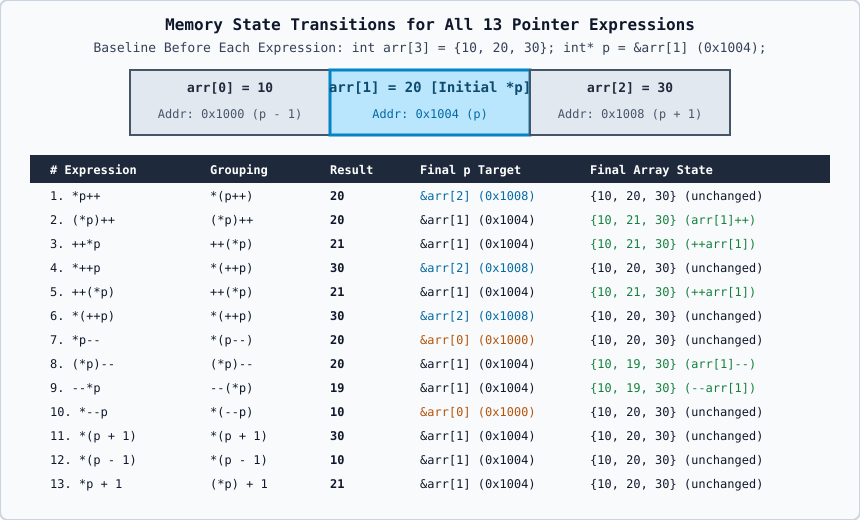

# 02 — Pointer Arithmetic, Sequencing, and the 13 Classic Pointer Expressions



---

## 1. How Pointer Arithmetic Works Internally

When a pointer `T* p` points to an element of an array `T arr[N]`, adding or subtracting an integer `k` scales the byte offset automatically by `sizeof(T)`:

$$\text{New Address}(p + k) = \text{Address}(p) + k \times \text{sizeof}(T)$$

For example, assuming `sizeof(int) == 4` and an array `int arr[3] = {10, 20, 30};` starting at base address `0x1000`:
- `&arr[0]` (`p - 1` if `p == &arr[1]`) is `0x1000` (holds `10`).
- `&arr[1]` (`p`) is `0x1004` (holds `20`).
- `&arr[2]` (`p + 1` if `p == &arr[1]`) is `0x1008` (holds `30`).
- `&arr[3]` (one-past-the-end pointer) is `0x100C` (valid to form and compare, **Undefined Behavior** to dereference).

---

## 2. Precedence vs. Associativity vs. Evaluation Order (Crucial Distinction!)

Before analyzing the 13 expressions, you must never confuse three distinct C++ rules:

1. **Operator Precedence**: Determines which operator binds more tightly to an operand when parentheses are absent:
   - **Level 2 (Higher)**: Postfix increment `expr++` and postfix decrement `expr--` (Associativity: **Left-to-Right**).
   - **Level 3 (Lower than Level 2)**: Prefix increment `++expr`, prefix decrement `--expr`, and unary dereference `*expr` (Associativity: **Right-to-Left**).
   - **Level 6**: Binary addition `+` and subtraction `-` (Associativity: **Left-to-Right**).
2. **Operator Associativity**: Determines how operators of the **same** precedence level group when adjacent. Because unary `*` and prefix `++` both sit at Level 3 with **Right-to-Left** associativity:
   - `++*p` groups from right to left as `++(*p)`.
   - `*++p` groups from right to left as `*(++p)`.
   - By contrast, in `*p++`, postfix `++` is at Level 2 (higher than unary `*` at Level 3), so `*p++` **always** groups as `*(p++)`, **never** as `(*p)++`!
3. **Evaluation Order & Sequencing (`[intro.execution]`)**:
   - Precedence and associativity only define the **parse tree** (how subexpressions are grouped); they do **NOT** by themselves define the runtime order in which separate subexpressions are evaluated!
   - Why does `*p++` dereference the *old* pointer value even though `p++` binds tighter? Because the semantics of postfix `p++` are: **yield a temporary copy of the original pointer value `p` as the result of the subexpression `p++`**, while scheduling the side effect (`p = p + 1`). The unary `*` operator then dereferences that yielded *original* address!

---

## 3. Baseline Setup for All 13 Independent Expressions

To compare all 13 expressions fairly and without ambiguity, assume that **before each expression runs**, we reset an array and pointer to the following exact state:

```cpp
int arr[3] = {10, 20, 30};
int* p = &arr[1]; // p starts at index 1 (address 0x1004, pointing to 20)
int result = <EXPRESSION>;
```

- Initial array: `arr[0] = 10` (`0x1000`), `arr[1] = 20` (`0x1004`), `arr[2] = 30` (`0x1008`).
- Initial pointer: `p = &arr[1]` (`0x1004`, so `*p` is initially `20`).

---

## 4. Independent Analysis of All 13 Pointer Expressions

### Expression 1: `*p++`

1. **Operator Precedence**: Postfix `++` (Level 2) has higher precedence than unary `*` (Level 3).
2. **Associativity**: Postfix `++` is Left-to-Right; unary `*` is Right-to-Left. Grouping is `*(p++)`.
3. **Exact Meaning**: Advance pointer `p` to the next array element, but dereference the **old** address that `p` held before incrementing.
4. **Does the pointer change?**: **YES** (`p` moves from `&arr[1]` to `&arr[2]`).
5. **Does the pointed-to value change?**: **NO** (all array elements remain `{10, 20, 30}`).
6. **Step-by-Step Execution**:
   - Step 1: `p++` evaluates to the old address `&arr[1]` (`0x1004`) and increments `p` to `&arr[2]` (`0x1008`).
   - Step 2: `*` dereferences the yielded old address `0x1004`, fetching `arr[1]` (`20`).
   - Step 3: `result` receives `20`.
7. **Dry-Run Table**:
   | Step | Action | `p` (Address) | `arr[0]` | `arr[1]` | `arr[2]` | `result` |
   | :--- | :--- | :--- | :---: | :---: | :---: | :---: |
   | Initial | `p = &arr[1]` | `0x1004` (`&arr[1]`) | `10` | `20` | `30` | — |
   | After `result = *p++` | Dereference old `p`, increment `p` | `0x1008` (`&arr[2]`) | `10` | `20` | `30` | `20` |
8. **Final Pointer Position**: `&arr[2]` (`0x1008`, pointing to `30`).
9. **Final Array Values**: `{10, 20, 30}`.

---

### Expression 2: `(*p)++`

1. **Operator Precedence**: Parentheses `()` (Level 1) override default precedence, forcing `*p` to be evaluated first, followed by postfix `++` (Level 2) on the resulting lvalue `arr[1]`.
2. **Associativity**: N/A (explicit parentheses).
3. **Exact Meaning**: Dereference `p` to get the integer variable `arr[1]`, yield its old value (`20`), and increment that integer variable in memory (`arr[1]` becomes `21`).
4. **Does the pointer change?**: **NO** (`p` stays at `&arr[1]`).
5. **Does the pointed-to value change?**: **YES** (`arr[1]` changes from `20` to `21`).
6. **Step-by-Step Execution**:
   - Step 1: `(*p)` dereferences `p` (`&arr[1]`), producing the lvalue `arr[1]`.
   - Step 2: Postfix `++` yields the old value of `arr[1]` (`20`) and increments `arr[1]` to `21`.
   - Step 3: `result` receives `20`.
7. **Dry-Run Table**:
   | Step | Action | `p` (Address) | `arr[0]` | `arr[1]` | `arr[2]` | `result` |
   | :--- | :--- | :--- | :---: | :---: | :---: | :---: |
   | Initial | `p = &arr[1]` | `0x1004` (`&arr[1]`) | `10` | `20` | `30` | — |
   | After `result = (*p)++` | Post-increment `arr[1]` | `0x1004` (`&arr[1]`) | `10` | `21` | `30` | `20` |
8. **Final Pointer Position**: `&arr[1]` (`0x1004`, pointing to `21`).
9. **Final Array Values**: `{10, 21, 30}`.

---

### Expression 3: `++*p`

1. **Operator Precedence**: Prefix `++` and unary `*` share the **same** precedence (Level 3).
2. **Associativity**: Level 3 operators associate **Right-to-Left**, so `++*p` groups as `++(*p)`.
3. **Exact Meaning**: Dereference `p` to obtain the lvalue `arr[1]`, pre-increment `arr[1]` from `20` to `21`, and yield the updated lvalue (`21`).
4. **Does the pointer change?**: **NO** (`p` stays at `&arr[1]`).
5. **Does the pointed-to value change?**: **YES** (`arr[1]` changes from `20` to `21`).
6. **Step-by-Step Execution**:
   - Step 1: Inner right-hand operator `*p` accesses `arr[1]`.
   - Step 2: Outer left-hand operator `++` increments `arr[1]` in place from `20` to `21` and yields `21`.
   - Step 3: `result` receives `21`.
7. **Dry-Run Table**:
   | Step | Action | `p` (Address) | `arr[0]` | `arr[1]` | `arr[2]` | `result` |
   | :--- | :--- | :--- | :---: | :---: | :---: | :---: |
   | Initial | `p = &arr[1]` | `0x1004` (`&arr[1]`) | `10` | `20` | `30` | — |
   | After `result = ++*p` | Pre-increment `arr[1]` | `0x1004` (`&arr[1]`) | `10` | `21` | `30` | `21` |
8. **Final Pointer Position**: `&arr[1]` (`0x1004`, pointing to `21`).
9. **Final Array Values**: `{10, 21, 30}`.

---

### Expression 4: `*++p`

1. **Operator Precedence**: Unary `*` and prefix `++` share the **same** precedence (Level 3).
2. **Associativity**: **Right-to-Left**, so `*++p` groups as `*(++p)`.
3. **Exact Meaning**: Pre-increment the pointer `p` so it points to the next element (`&arr[2]`), and then dereference the **new** pointer address (`arr[2]`).
4. **Does the pointer change?**: **YES** (`p` moves from `&arr[1]` to `&arr[2]`).
5. **Does the pointed-to value change?**: **NO** (array remains `{10, 20, 30}`).
6. **Step-by-Step Execution**:
   - Step 1: `++p` increments `p` from `&arr[1]` (`0x1004`) to `&arr[2]` (`0x1008`) and yields the updated pointer `p`.
   - Step 2: `*` dereferences `0x1008`, yielding `arr[2]` (`30`).
   - Step 3: `result` receives `30`.
7. **Dry-Run Table**:
   | Step | Action | `p` (Address) | `arr[0]` | `arr[1]` | `arr[2]` | `result` |
   | :--- | :--- | :--- | :---: | :---: | :---: | :---: |
   | Initial | `p = &arr[1]` | `0x1004` (`&arr[1]`) | `10` | `20` | `30` | — |
   | After `result = *++p` | Pre-increment `p`, then dereference | `0x1008` (`&arr[2]`) | `10` | `20` | `30` | `30` |
8. **Final Pointer Position**: `&arr[2]` (`0x1008`, pointing to `30`).
9. **Final Array Values**: `{10, 20, 30}`.

---

### Expression 5: `++(*p)`

1. **Operator Precedence**: Parentheses `()` (Level 1) explicitly group `*p`, and prefix `++` (Level 3) applies to that dereferenced lvalue.
2. **Associativity**: Identical in grouping and behavior to `++*p` (Expression 3).
3. **Exact Meaning**: Explicitly dereference `p` first (`arr[1]`), pre-increment `arr[1]` from `20` to `21`, and yield the new value `21`.
4. **Does the pointer change?**: **NO** (`p` stays at `&arr[1]`).
5. **Does the pointed-to value change?**: **YES** (`arr[1]` becomes `21`).
6. **Step-by-Step Execution**:
   - Step 1: `(*p)` yields the lvalue `arr[1]`.
   - Step 2: `++` increments `arr[1]` to `21` and returns `21`.
   - Step 3: `result` receives `21`.
7. **Dry-Run Table**:
   | Step | Action | `p` (Address) | `arr[0]` | `arr[1]` | `arr[2]` | `result` |
   | :--- | :--- | :--- | :---: | :---: | :---: | :---: |
   | Initial | `p = &arr[1]` | `0x1004` (`&arr[1]`) | `10` | `20` | `30` | — |
   | After `result = ++(*p)` | Pre-increment `arr[1]` | `0x1004` (`&arr[1]`) | `10` | `21` | `30` | `21` |
8. **Final Pointer Position**: `&arr[1]` (`0x1004`, pointing to `21`).
9. **Final Array Values**: `{10, 21, 30}`.

---

### Expression 6: `*(++p)`

1. **Operator Precedence**: Parentheses `()` (Level 1) explicitly group `++p`, and unary `*` (Level 3) dereferences the result.
2. **Associativity**: Identical in grouping and behavior to `*++p` (Expression 4).
3. **Exact Meaning**: Pre-increment the pointer `p` to `&arr[2]` first, then dereference the updated pointer to obtain `arr[2]` (`30`).
4. **Does the pointer change?**: **YES** (`p` moves from `&arr[1]` to `&arr[2]`).
5. **Does the pointed-to value change?**: **NO** (array remains `{10, 20, 30}`).
6. **Step-by-Step Execution**:
   - Step 1: `(++p)` advances `p` to `&arr[2]` (`0x1008`).
   - Step 2: `*` dereferences `0x1008`, yielding `30`.
   - Step 3: `result` receives `30`.
7. **Dry-Run Table**:
   | Step | Action | `p` (Address) | `arr[0]` | `arr[1]` | `arr[2]` | `result` |
   | :--- | :--- | :--- | :---: | :---: | :---: | :---: |
   | Initial | `p = &arr[1]` | `0x1004` (`&arr[1]`) | `10` | `20` | `30` | — |
   | After `result = *(++p)` | Pre-increment `p`, then dereference | `0x1008` (`&arr[2]`) | `10` | `20` | `30` | `30` |
8. **Final Pointer Position**: `&arr[2]` (`0x1008`, pointing to `30`).
9. **Final Array Values**: `{10, 20, 30}`.

---

### Expression 7: `*p--`

1. **Operator Precedence**: Postfix `--` (Level 2) has higher precedence than unary `*` (Level 3).
2. **Associativity**: Groups as `*(p--)`.
3. **Exact Meaning**: Decrement pointer `p` to the previous array element (`&arr[0]`), while dereferencing the **old** pointer address (`&arr[1]`).
4. **Does the pointer change?**: **YES** (`p` moves backward from `&arr[1]` to `&arr[0]`).
5. **Does the pointed-to value change?**: **NO** (array remains `{10, 20, 30}`).
6. **Step-by-Step Execution**:
   - Step 1: `p--` yields the old address `&arr[1]` (`0x1004`) and decrements `p` to `&arr[0]` (`0x1000`).
   - Step 2: `*` dereferences the yielded old address `0x1004`, reading `arr[1]` (`20`).
   - Step 3: `result` receives `20`.
7. **Dry-Run Table**:
   | Step | Action | `p` (Address) | `arr[0]` | `arr[1]` | `arr[2]` | `result` |
   | :--- | :--- | :--- | :---: | :---: | :---: | :---: |
   | Initial | `p = &arr[1]` | `0x1004` (`&arr[1]`) | `10` | `20` | `30` | — |
   | After `result = *p--` | Dereference old `p`, decrement `p` | `0x1000` (`&arr[0]`) | `10` | `20` | `30` | `20` |
8. **Final Pointer Position**: `&arr[0]` (`0x1000`, pointing to `10`).
9. **Final Array Values**: `{10, 20, 30}`.

---

### Expression 8: `(*p)--`

1. **Operator Precedence**: Parentheses `()` (Level 1) force `*p` first; postfix `--` (Level 2) applies to the dereferenced lvalue `arr[1]`.
2. **Associativity**: N/A (explicit parentheses).
3. **Exact Meaning**: Dereference `p` to get `arr[1]`, yield its old value (`20`), and decrement `arr[1]` in place to `19`.
4. **Does the pointer change?**: **NO** (`p` stays at `&arr[1]`).
5. **Does the pointed-to value change?**: **YES** (`arr[1]` changes from `20` to `19`).
6. **Step-by-Step Execution**:
   - Step 1: `(*p)` accesses lvalue `arr[1]`.
   - Step 2: Postfix `--` yields `20` and decrements `arr[1]` to `19`.
   - Step 3: `result` receives `20`.
7. **Dry-Run Table**:
   | Step | Action | `p` (Address) | `arr[0]` | `arr[1]` | `arr[2]` | `result` |
   | :--- | :--- | :--- | :---: | :---: | :---: | :---: |
   | Initial | `p = &arr[1]` | `0x1004` (`&arr[1]`) | `10` | `20` | `30` | — |
   | After `result = (*p)--` | Post-decrement `arr[1]` | `0x1004` (`&arr[1]`) | `10` | `19` | `30` | `20` |
8. **Final Pointer Position**: `&arr[1]` (`0x1004`, pointing to `19`).
9. **Final Array Values**: `{10, 19, 30}`.

---

### Expression 9: `--*p`

1. **Operator Precedence**: Prefix `--` and unary `*` share Level 3.
2. **Associativity**: **Right-to-Left**, so `--*p` groups as `--(*p)`.
3. **Exact Meaning**: Dereference `p` to get lvalue `arr[1]`, pre-decrement `arr[1]` from `20` to `19`, and yield `19`.
4. **Does the pointer change?**: **NO** (`p` stays at `&arr[1]`).
5. **Does the pointed-to value change?**: **YES** (`arr[1]` changes from `20` to `19`).
6. **Step-by-Step Execution**:
   - Step 1: `*p` accesses lvalue `arr[1]`.
   - Step 2: Prefix `--` decrements `arr[1]` to `19` and yields `19`.
   - Step 3: `result` receives `19`.
7. **Dry-Run Table**:
   | Step | Action | `p` (Address) | `arr[0]` | `arr[1]` | `arr[2]` | `result` |
   | :--- | :--- | :--- | :---: | :---: | :---: | :---: |
   | Initial | `p = &arr[1]` | `0x1004` (`&arr[1]`) | `10` | `20` | `30` | — |
   | After `result = --*p` | Pre-decrement `arr[1]` | `0x1004` (`&arr[1]`) | `10` | `19` | `30` | `19` |
8. **Final Pointer Position**: `&arr[1]` (`0x1004`, pointing to `19`).
9. **Final Array Values**: `{10, 19, 30}`.

---

### Expression 10: `*--p`

1. **Operator Precedence**: Unary `*` and prefix `--` share Level 3.
2. **Associativity**: **Right-to-Left**, so `*--p` groups as `*(--p)`.
3. **Exact Meaning**: Pre-decrement pointer `p` from `&arr[1]` to `&arr[0]`, then dereference the new address `&arr[0]` to yield `10`.
4. **Does the pointer change?**: **YES** (`p` moves from `&arr[1]` to `&arr[0]`).
5. **Does the pointed-to value change?**: **NO** (array remains `{10, 20, 30}`).
6. **Step-by-Step Execution**:
   - Step 1: `--p` decrements `p` to `&arr[0]` (`0x1000`) and yields `p`.
   - Step 2: `*` dereferences `0x1000`, yielding `arr[0]` (`10`).
   - Step 3: `result` receives `10`.
7. **Dry-Run Table**:
   | Step | Action | `p` (Address) | `arr[0]` | `arr[1]` | `arr[2]` | `result` |
   | :--- | :--- | :--- | :---: | :---: | :---: | :---: |
   | Initial | `p = &arr[1]` | `0x1004` (`&arr[1]`) | `10` | `20` | `30` | — |
   | After `result = *--p` | Pre-decrement `p`, then dereference | `0x1000` (`&arr[0]`) | `10` | `20` | `30` | `10` |
8. **Final Pointer Position**: `&arr[0]` (`0x1000`, pointing to `10`).
9. **Final Array Values**: `{10, 20, 30}`.

---

### Expression 11: `*(p + 1)`

1. **Operator Precedence**: Parentheses `()` (Level 1) evaluate binary addition `p + 1` (Level 6) before unary `*` (Level 3).
2. **Associativity**: N/A (parenthesized).
3. **Exact Meaning**: Compute a temporary address one element after `p` (`&arr[2]`) and dereference that temporary address **without modifying `p`**. Equivalent to `p[1]`.
4. **Does the pointer change?**: **NO** (`p` stays at `&arr[1]` because `+` does not assign back to `p`).
5. **Does the pointed-to value change?**: **NO** (array remains `{10, 20, 30}`).
6. **Step-by-Step Execution**:
   - Step 1: `p + 1` computes temporary pointer `&arr[1] + 1 == &arr[2]` (`0x1008`). `p` itself remains `0x1004`.
   - Step 2: `*` dereferences `0x1008`, yielding `arr[2]` (`30`).
   - Step 3: `result` receives `30`.
7. **Dry-Run Table**:
   | Step | Action | `p` (Address) | `arr[0]` | `arr[1]` | `arr[2]` | `result` |
   | :--- | :--- | :--- | :---: | :---: | :---: | :---: |
   | Initial | `p = &arr[1]` | `0x1004` (`&arr[1]`) | `10` | `20` | `30` | — |
   | After `result = *(p + 1)` | Read element at `p + 1` | `0x1004` (`&arr[1]`) | `10` | `20` | `30` | `30` |
8. **Final Pointer Position**: `&arr[1]` (`0x1004`, pointing to `20`).
9. **Final Array Values**: `{10, 20, 30}`.

---

### Expression 12: `*(p - 1)`

1. **Operator Precedence**: Parentheses `()` (Level 1) evaluate binary subtraction `p - 1` (Level 6) before unary `*` (Level 3).
2. **Associativity**: N/A (parenthesized).
3. **Exact Meaning**: Compute a temporary address one element before `p` (`&arr[0]`) and dereference that temporary address **without modifying `p`**. Equivalent to `p[-1]`.
4. **Does the pointer change?**: **NO** (`p` stays at `&arr[1]`).
5. **Does the pointed-to value change?**: **NO** (array remains `{10, 20, 30}`).
6. **Step-by-Step Execution**:
   - Step 1: `p - 1` computes temporary pointer `&arr[1] - 1 == &arr[0]` (`0x1000`). `p` remains `0x1004`.
   - Step 2: `*` dereferences `0x1000`, yielding `arr[0]` (`10`).
   - Step 3: `result` receives `10`.
7. **Dry-Run Table**:
   | Step | Action | `p` (Address) | `arr[0]` | `arr[1]` | `arr[2]` | `result` |
   | :--- | :--- | :--- | :---: | :---: | :---: | :---: |
   | Initial | `p = &arr[1]` | `0x1004` (`&arr[1]`) | `10` | `20` | `30` | — |
   | After `result = *(p - 1)` | Read element at `p - 1` | `0x1004` (`&arr[1]`) | `10` | `20` | `30` | `10` |
8. **Final Pointer Position**: `&arr[1]` (`0x1004`, pointing to `20`).
9. **Final Array Values**: `{10, 20, 30}`.

---

### Expression 13: `*p + 1`

1. **Operator Precedence**: Unary `*` (Level 3) has higher precedence than binary `+` (Level 6).
2. **Associativity**: Groups as `(*p) + 1`.
3. **Exact Meaning**: Dereference `p` to read the integer value `arr[1]` (`20`), and add `1` to that integer value (`20 + 1 == 21`) **without modifying `p` or `arr[1]`**.
4. **Does the pointer change?**: **NO** (`p` stays at `&arr[1]`).
5. **Does the pointed-to value change?**: **NO** (`arr[1]` stays `20` because `+ 1` produces a temporary prvalue; it does not assign back to `*p`).
6. **Step-by-Step Execution**:
   - Step 1: `*p` reads `arr[1]` (`20`).
   - Step 2: `20 + 1` computes temporary integer `21`.
   - Step 3: `result` receives `21`.
7. **Dry-Run Table**:
   | Step | Action | `p` (Address) | `arr[0]` | `arr[1]` | `arr[2]` | `result` |
   | :--- | :--- | :--- | :---: | :---: | :---: | :---: |
   | Initial | `p = &arr[1]` | `0x1004` (`&arr[1]`) | `10` | `20` | `30` | — |
   | After `result = *p + 1` | Read `*p` and add `1` | `0x1004` (`&arr[1]`) | `10` | `20` | `30` | `21` |
8. **Final Pointer Position**: `&arr[1]` (`0x1004`, pointing to `20`).
9. **Final Array Values**: `{10, 20, 30}`.

---

## 5. Master Summary Table of All 13 Expressions

*(Initial state before each row: `int arr[3] = {10, 20, 30}; int* p = &arr[1];`)*

| # | Expression | Effective Grouping | Pointer `p` Changes? | Array Value Changes? | Final `p` Target | Final `arr` State | Returned `result` |
| :---: | :--- | :--- | :---: | :---: | :---: | :---: | :---: |
| 1 | `*p++` | `*(p++)` | **Yes** (`&arr[2]`) | No | `arr[2]` (`30`) | `{10, 20, 30}` | **`20`** |
| 2 | `(*p)++` | `(*p)++` | No (`&arr[1]`) | **Yes** (`arr[1]=21`) | `arr[1]` (`21`) | `{10, 21, 30}` | **`20`** |
| 3 | `++*p` | `++(*p)` | No (`&arr[1]`) | **Yes** (`arr[1]=21`) | `arr[1]` (`21`) | `{10, 21, 30}` | **`21`** |
| 4 | `*++p` | `*(++p)` | **Yes** (`&arr[2]`) | No | `arr[2]` (`30`) | `{10, 20, 30}` | **`30`** |
| 5 | `++(*p)` | `++(*p)` | No (`&arr[1]`) | **Yes** (`arr[1]=21`) | `arr[1]` (`21`) | `{10, 21, 30}` | **`21`** |
| 6 | `*(++p)` | `*(++p)` | **Yes** (`&arr[2]`) | No | `arr[2]` (`30`) | `{10, 20, 30}` | **`30`** |
| 7 | `*p--` | `*(p--)` | **Yes** (`&arr[0]`) | No | `arr[0]` (`10`) | `{10, 20, 30}` | **`20`** |
| 8 | `(*p)--` | `(*p)--` | No (`&arr[1]`) | **Yes** (`arr[1]=19`) | `arr[1]` (`19`) | `{10, 19, 30}` | **`20`** |
| 9 | `--*p` | `--(*p)` | No (`&arr[1]`) | **Yes** (`arr[1]=19`) | `arr[1]` (`19`) | `{10, 19, 30}` | **`19`** |
| 10 | `*--p` | `*(--p)` | **Yes** (`&arr[0]`) | No | `arr[0]` (`10`) | `{10, 20, 30}` | **`10`** |
| 11 | `*(p + 1)` | `*(p + 1)` | No (`&arr[1]`) | No | `arr[1]` (`20`) | `{10, 20, 30}` | **`30`** |
| 12 | `*(p - 1)` | `*(p - 1)` | No (`&arr[1]`) | No | `arr[1]` (`20`) | `{10, 20, 30}` | **`10`** |
| 13 | `*p + 1` | `(*p) + 1` | No (`&arr[1]`) | No | `arr[1]` (`20`) | `{10, 20, 30}` | **`21`** |

---

## 6. Why `*p++ + *p++` is Undefined Behavior (Sequencing Rules)

Students frequently see university trick questions like:

```cpp
int arr[3] = {10, 20, 30};
int* p = &arr[0];
int x = *p++ + *p++; // WARNING: UNDEFINED BEHAVIOR!
```

### The Exact C++ Standard Rule (`[intro.execution]`)
1. The binary addition operator `+` does **not** impose a sequencing order between the evaluation of its left operand (`*p++`) and its right operand (`*p++`).
2. Both operands modify the same scalar object `p` (via the side effect of `p++`).
3. According to ISO C++ (`[intro.execution]`): *"If a side effect on a memory location is unsequenced relative to either another side effect on the same memory location or a value computation using the value of any object in the same memory location, and they are not potentially concurrent, the behavior is undefined."*
4. Even in C++17, C++20, and C++23 (which tightened evaluation order for `a << b`, `a.b`, `a[b]`, and assignment right-to-left), the operands of binary `+`, `-`, `*`, `/` remain **unsequenced** relative to each other!
5. **Exam Rule**: Never state a single "guaranteed" numerical output (`20` or `30`) as standard C++ behavior for `*p++ + *p++`. Always write: **"The expression exhibits Undefined Behavior (UB) due to unsequenced side effects on the scalar pointer `p` within the binary `+` expression."**
