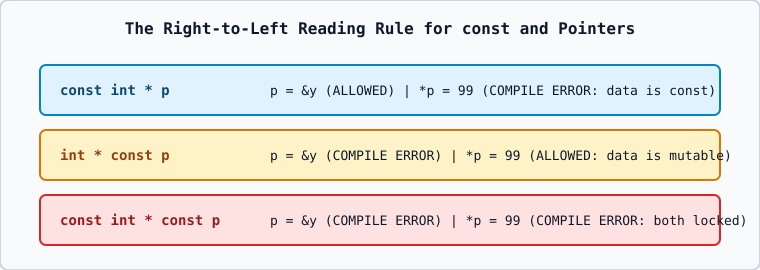

# 03 — `const` Pointers, Arrays, Functions, Strings, and Objects



---

## 1. The Three Combinations of `const` and Pointers

Read pointer declarations **from right to left** (the "Clockwise / Right-to-Left Rule", splitting at the `*`):

### A. Pointer to Constant Data (`const int* p` or `int const* p`)
- **Reading right-to-left**: `p` is a pointer (`*`) to an `int` that is `const`.
- **What is locked?**: The **pointed-to value** (`*p = 50;` is a **Compilation Error**).
- **What is mutable?**: The **pointer address itself** (`p = &other_var;` is **Allowed**).

### B. Constant Pointer to Mutable Data (`int* const p`)
- **Reading right-to-left**: `p` is a `const` pointer (`* const`) to a mutable `int`.
- **What is locked?**: The **pointer address itself** (`p = &other_var;` is a **Compilation Error**; `p` must be initialized when declared).
- **What is mutable?**: The **pointed-to value** (`*p = 50;` is **Allowed**).

### C. Constant Pointer to Constant Data (`const int* const p`)
- **Reading right-to-left**: `p` is a `const` pointer (`* const`) to an `int` that is `const`.
- **What is locked?**: **Both** the pointer address (`p = &other_var;` fails) and the pointed-to value (`*p = 50;` fails).

| Declaration | Can reassign `p = &y`? | Can modify `*p = 99`? | Common Use Case |
| :--- | :---: | :---: | :--- |
| `int* p` | Yes | Yes | Mutating both target and which object is tracked |
| `const int* p` | **Yes** | **No** | Iterating through read-only array elements |
| `int* const p` | **No** | **Yes** | Fixed hardware register or permanent buffer handle |
| `const int* const p` | **No** | **No** | Fixed read-only lookup address |

---

## 2. Pointers and Arrays

When an array is declared:

```cpp
int arr[4] = {10, 20, 30, 40};
```

In almost all expressions, the array identifier `arr` **decays** implicitly into a pointer to its first element (`&arr[0]` of type `int*`).

- `arr[i]` is defined by the C++ compiler as syntactic sugar for `*(arr + i)`.
- **Exceptions where `arr` does NOT decay to a pointer**:
  1. `sizeof(arr)`: Returns the size of the entire array (`4 * sizeof(int) = 16` bytes), whereas `sizeof(p)` returns the size of a pointer (`8` bytes on 64-bit systems).
  2. `&arr`: Returns a pointer to the entire 4-element array (`int (*)[4]`), so `&arr + 1` steps past all 4 elements (`+16` bytes)!
- **Crucial Distinction**: An array name `arr` is **not** a modifiable lvalue pointer; writing `arr++` or `arr = p` is a **compilation error**.

---

## 3. Pointers and Functions (Call by Address)

When you pass a pointer to a function, the function receives a copy of the **memory address**, allowing it to dereference that address and mutate the caller's original variable:

```cpp
void update_age(int* ptr) {
    if (ptr != nullptr) {
        *ptr = 25; // Modifies caller's variable directly in memory
    }
}
```

---

## 4. Pointers and Strings

1. **C-Style String Literal Pointer (`const char*`)**:
   ```cpp
   const char* msg = "Hello";
   ```
   String literals are stored in read-only static memory (`const char[6]`). In modern C++ (since C++11 through C++23), assigning a string literal to a non-const `char*` (`char* s = "Hello";`) is **ill-formed (Compilation Error)** because mutating a string literal is Undefined Behavior.
2. **Modern `std::string`**:
   Prefer `std::string` (`#include <string>`) for safe, automatic memory management, bounds checking (`.at()`), and length tracking (`.length()`).

---

## 5. Pointers and Classroom Objects (`->` Member Access Operator)

Using our classroom `person` class:

```cpp
person p;
person* ptr = &p;

ptr->input(20);   // Equivalent to (*ptr).input(20);
ptr->display();   // Equivalent to (*ptr).display();
```

Why are parentheses required in `(*ptr).display()`?
Because the dot member-access operator `.` (Precedence Level 2) has **higher** precedence than unary `*` (Precedence Level 3). Writing `*ptr.display()` would be parsed as `*(ptr.display())`, which fails to compile because `ptr` is a pointer, not a class object! The arrow operator `ptr->display()` was invented specifically as clean syntax for `(*ptr).display()`.
