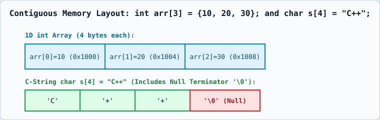

# 01 — 1D and 2D Arrays and Contiguous Row-Major Memory Layout



## 1. Definition & Intuition
An **array** is a fixed-size, contiguous collection of elements of the exact same data type stored back-to-back in memory.

```cpp
int marks[5] = {80, 85, 90, 75, 95};
```

## 2. Address Calculation Formula
- **1D Array (`T arr[N]`)**:
  $$\text{Address}(\text{arr}[i]) = \text{BaseAddress}(\text{arr}) + i \times \text{sizeof}(T)$$
- **2D Array (`T mat[R][C]`, Row-Major Order in C++)**:
  C++ stores 2D arrays row by row in a single contiguous block:
  $$\text{Address}(\text{mat}[i][j]) = \text{BaseAddress}(\text{mat}) + (i \times C + j) \times \text{sizeof}(T)$$

## 3. Rules, Zero-Initialization, and Out-of-Bounds Undefined Behavior
1. **Compile-Time Constant Bound**: Standard C++ arrays (`int arr[N]`) require `N` to be a compile-time constant expression (`constexpr`). Variable Length Arrays (`int n; cin >> n; int arr[n];`) are a non-standard C99 compiler extension and are **ill-formed in strict ISO C++ (`-Wpedantic`)**.
2. **Partial Initialization**: `int arr[5] = {10, 20};` initializes `arr[0]=10, arr[1]=20`, and automatically zero-initializes `arr[2]=0, arr[3]=0, arr[4]=0`. Writing `int arr[5] = {};` zero-initializes all 5 elements.
3. **No Bounds Checking on `[]`**: Accessing `arr[5]` or `arr[-1]` on a 5-element array (`0..4`) is **Undefined Behavior**.
