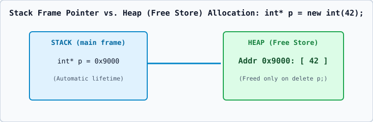

# 01 — Stack vs. Heap Memory and `new` / `delete`

## 1. Automatic Storage (Stack) vs. Dynamic Storage (Free Store / Heap)

| Property | Stack Memory (Automatic) | Heap / Free Store (Dynamic) |
| :--- | :--- | :--- |
| **Allocation Mechanism** | Automatic when entering block scope `{}` | Explicit via `new` or `new[]` |
| **Deallocation** | Automatic LIFO pop when leaving block scope | Explicit via `delete` or `delete[]` (or RAII destructor) |
| **Size Requirement** | Must be known at compile time (`int arr[10];`) | Can be determined at runtime (`new int[n];`) |
| **Lifetime** | Tied strictly to the enclosing block scope | Persists until explicitly freed (`delete`) |
| **Failure Mode** | Stack overflow if recursion/arrays exceed stack limit | Throws `std::bad_alloc` if heap is exhausted |

## 2. How `new` and `delete` Work Internally
1. **`T* p = new T(args);`**:
   - Step 1: Calls `operator new(sizeof(T))` to allocate raw bytes on the free store.
   - Step 2: Invokes the constructor `T::T(args)` on that memory block.
   - Step 3: Returns a typed pointer `T*`.
2. **`delete p;`**:
   - Step 1: Invokes the destructor `p->~T()` (if `T` is a class type).
   - Step 2: Calls `operator delete` to return the raw memory to the free store.
   - *(Note: In C++, `delete nullptr;` is guaranteed by the standard to be a safe no-op!)*
