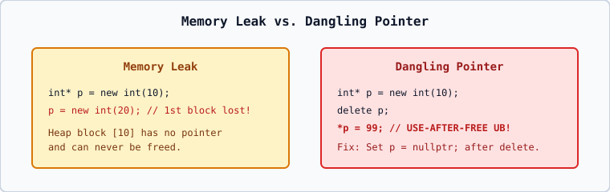

# 03 — Memory Leaks, Dangling Pointers, Double Deletion, and RAII

## 1. Summary of Dynamic Memory Bugs
1. **Memory Leak**: Overwriting or losing the last pointer to a heap block without calling `delete`.
2. **Dangling Pointer (Use-After-Free)**: Dereferencing a pointer after `delete p;` has already freed the target object.
3. **Double Deletion**: Calling `delete p;` twice on the same heap address.
4. **Mismatched Deallocation**: Mixing `new[]` with `delete`, or `malloc()` with `delete`.

## 2. Modern C++23 Recommendation
- For a **single dynamic object**, prefer `std::unique_ptr<person> p = std::make_unique<person>();`.
- For a **dynamic array whose size is known at runtime**, prefer `std::vector<int> arr(n);`.
