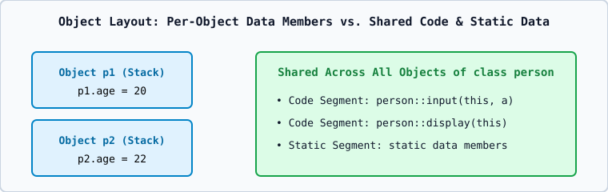

# 01 — Classes, Objects, Encapsulation, and the Baseline Classroom `person` Program



## 1. The Baseline Classroom `person` Program
```cpp
#include <iostream>
using namespace std;

class person {
private:
    int age;

public:
    void input(int a) {
        age = a;
    }

    void display() {
        cout << "Age: " << age << endl;
    }
};

int main() {
    person p;

    p.input(20);
    p.display();

    return 0;
}
```

### Line-by-Line Execution and Memory Walkthrough
1. **Class Definition (`class person`)**: Defines a blueprint (consumes 0 bytes of runtime memory until an object is instantiated).
2. **`private: int age;`**: Hides `age` so outside functions like `main()` cannot write `p.age = -5;`.
3. **`public: void input(int a)` and `void display()`**: Public interface functions that can read and modify `age`.
4. **`person p;` in `main()`**: Allocates `sizeof(person)` (`4` bytes for `int age`) on the stack frame of `main()`.
5. **`p.input(20);`**: Calls `person::input` with hidden `this = &p` and sets `p.age = 20`.
6. **`p.display();`**: Reads `p.age` (`20`) and prints `Age: 20`.

## 2. Difference Between `class` and `struct` in C++
In C++, `struct` and `class` are identical in capabilities (both can have constructors, member functions, inheritance, and access specifiers) with only **two default differences**:
1. Default member access is `private` in a `class`, and `public` in a `struct`.
2. Default inheritance mode is `private` for a `class`, and `public` for a `struct`.
