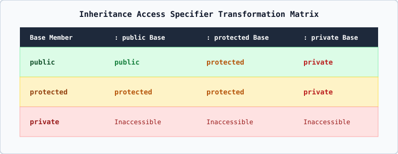

# 01 — Inheritance Fundamentals and Access Specifier Transformation



---

## 1. Definition & Intuition

**Inheritance** is the object-oriented mechanism by which a new class (called the **derived class** or **sub class** or **child class**) acquires the data members and member functions of an existing class (called the **base class** or **super class** or **parent class**), while adding its own specialized members or overriding existing behavior.

### Real-World Analogy
Every `student` **is a** `person`. A `person` has `age` and `name`. Instead of rewriting `age` and `name` inside `student`, `employee`, and `teacher`, we define `person` once as the **base class** and let `student` inherit from `person`.

---

## 2. Syntax of Inheritance

```cpp
class base_class {
    // base members
};

class derived_class : access_mode base_class {
    // derived members
};
```

- `access_mode` (also called the *base-specifier*) can be `public`, `protected`, or `private`.
- **Default Inheritance Rule**: If `access_mode` is omitted:
  - For a `class` (`class sub : super`), the default inheritance mode is **`private`**.
  - For a `struct` (`struct sub : super`), the default inheritance mode is **`public`**.

---

## 3. The Three Member Access Specifiers vs. The Three Inheritance Modes

Never confuse **where a member is declared in the base class** with **how the derived class inherits the base class**!

### A. Base Class Member Access Specifiers
1. **`private` in Base**: Accessible **only** inside member functions (and `friend`s) of the Base class itself. Even the Derived class **cannot** directly touch `private` members of Base! (Note: the `private` data members of Base *are* still physically present inside every Derived object in memory; they just can only be accessed via `public` or `protected` functions of Base.)
2. **`protected` in Base**: Accessible inside Base **and** inside member functions of Derived classes, but **inaccessible** from outside code (such as `main()`).
3. **`public` in Base**: Accessible everywhere (unless restricted by `protected` or `private` inheritance in the derived class).

### B. Master Access Conversion Table (`[class.access.base]`)

| Base Class Member Access | `class Sub : public Super` | `class Sub : protected Super` | `class Sub : private Super` |
| :--- | :--- | :--- | :--- |
| **`public` in `Super`** | Becomes **`public`** in `Sub` | Becomes **`protected`** in `Sub` | Becomes **`private`** in `Sub` |
| **`protected` in `Super`** | Becomes **`protected`** in `Sub` | Becomes **`protected`** in `Sub` | Becomes **`private`** in `Sub` |
| **`private` in `Super`** | Not directly accessible in `Sub` | Not directly accessible in `Sub` | Not directly accessible in `Sub` |

---

## 4. Who Can Access Inherited Members Through What? (Exam Golden Rule)

| Effective Access of Inherited Member in `Sub` | Can `Sub`'s own member functions call it? | Can a further derived class `GrandSub : public Sub` call it? | Can `main()` call it via `Sub obj; obj.member()`? |
| :--- | :---: | :---: | :---: |
| **`public` in `Sub`** | **YES** | **YES** | **YES** |
| **`protected` in `Sub`** | **YES** | **YES** | **NO (Compile Error!)** |
| **`private` in `Sub`** | **YES** | **NO (Compile Error!)** | **NO (Compile Error!)** |
| *(Originally `private` in `Super`)* | **NO (Compile Error!)** | **NO (Compile Error!)** | **NO (Compile Error!)** |
