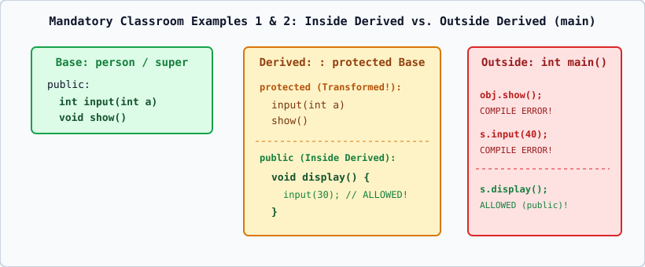

# 02 — Deep-Dive Analysis: Mandatory Classroom Examples 1 and 2



---

## 1. Mandatory Classroom Example 1: `super` and `sub` with `protected` Inheritance

### Original Classroom Program (Intentional Compilation Error)

```cpp
#include <iostream>
using namespace std;

class super {
public:
    void show() {
        cout << "hello from super" << endl;
    }
};

class sub : protected super {
};

int main() {
    sub obj;
    obj.show(); // Intentional compilation error
    return 0;
}
```

### Detailed Step-by-Step Technical Analysis
1. **In `class super`**: The member function `void show()` is declared under the `public:` access specifier. If we created a `super` object (`super s; s.show();`), that call would be completely legal.
2. **In `class sub : protected super`**: The inheritance mode is `protected`. According to C++ Standard `[class.access.base]`, when a base class is inherited as `protected`, every `public` member of the base class (`super::show()`) is transformed into a **`protected` member of the derived class (`sub`)**.
3. **In `int main()`**:
   - `main()` is a standalone non-member function outside `class sub`.
   - When `main()` executes `obj.show();` on `sub obj;`, name lookup finds `super::show()` through `sub`.
   - Because `show()` is **`protected` inside `sub`**, only member functions of `sub`, friends of `sub`, or classes further derived from `sub` are permitted to access it.
   - `main()` is **outside** the class hierarchy, so the compiler rejects `obj.show();` at compile time!

### Typical Compiler Diagnostic (GCC / Clang)
```text
error: 'void super::show()' is inaccessible within this context
note: declared here: void show()
error: 'super' is not an accessible base of 'sub'
```

### Two Ways to Fix Classroom Example 1
- **Fix Approach A (Change Inheritance Mode to `public`)**:
  ```cpp
  class sub : public super { };
  ```
  Now `super::show()` remains `public` in `sub`, so `obj.show();` in `main()` compiles and outputs `hello from super`. (See [`03_classroom_super_sub_fixed_public.cpp`](../02_PROGRAMS/03_classroom_super_sub_fixed_public.cpp)).
- **Fix Approach B (Keep `protected` Inheritance, Call `show()` from a `public` Member Function of `sub`)**:
  ```cpp
  class sub : protected super {
  public:
      void call_show() {
          show(); // LEGAL! Inside sub, protected inherited member show() is accessible!
      }
  };
  ```
  Then in `main()`, call `obj.call_show();`. (See [`04_classroom_super_sub_fixed_wrapper.cpp`](../02_PROGRAMS/04_classroom_super_sub_fixed_wrapper.cpp)).

---

## 2. Mandatory Classroom Example 2: `person` and `student` (Inside Derived vs. Outside Derived)

### Original Classroom Program (Intentional Compilation Error on `s.input(40)`)

```cpp
#include <iostream>
using namespace std;

class person {
public:
    int age;

    int input(int a) {
        age = a;
        return age;
    }
};

class student : protected person {
public:
    void display() {
        cout << input(30) << endl;
    }
};

int main() {
    student s;

    s.input(40); // Intentional compilation error

    s.display();
    return 0;
}
```

### Crucial Conceptual Distinction: Inside Derived (`display()`) vs. Outside Derived (`main()`)

Students often ask: *"If `student` inherits `person` as `protected`, why does `input(30)` work inside `display()`, whereas `s.input(40)` fails inside `main()`?"*

Let us trace the **Access Transformation** of every member of `person` when inherited by `class student : protected person`:

| Member in `person` | Original Access in `person` | Inheritance Mode in `student` | Effective Access in `student` | Accessible Inside `student::display()`? | Accessible Outside in `main()` via `s`? |
| :--- | :--- | :--- | :--- | :---: | :---: |
| `int age` | `public` | `protected` | **`protected`** | **YES** (Inside derived class) | **NO** (Compile Error!) |
| `int input(int a)` | `public` | `protected` | **`protected`** | **YES** (Inside derived class) | **NO** (Compile Error!) |
| `void display()` | *(Defined in `student`)* | N/A | **`public`** | **YES** | **YES** (`s.display()` is valid!) |

### Why `display()` Can Call `input(30)`
- `display()` is a **member function of `class student`**.
- Inside the body of `student::display()`, the code has full access to all `public`, `protected`, and `private` members of `student`.
- Because `person::input(int)` became a **`protected` member of `student`**, `student::display()` is completely authorized to call `input(30)` (which sets `this->age = 30` and returns `30`).

### Why `s.input(40)` Fails in `main()`
- `main()` is **outside** `class student`.
- Outside code can **only** access `public` members of `student` (`s.display()`).
- Because `input(int)` is `protected` inside `student`, writing `s.input(40);` in `main()` violates C++ access control (`[class.access.inh]`) and triggers a compile-time error!

### Corrected Version of Classroom Example 2
When the illegal line `s.input(40);` is removed (or commented out) in `main()`, leaving `s.display();`, the program compiles cleanly and prints:
```text
30
```
(See [`05_classroom_person_student_compile_error.cpp`](../02_PROGRAMS/05_classroom_person_student_compile_error.cpp) and [`06_classroom_person_student_corrected.cpp`](../02_PROGRAMS/06_classroom_person_student_corrected.cpp)).
