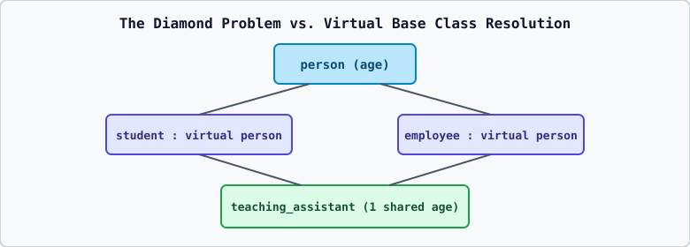

# 03 — Five Types of Inheritance, Constructor/Destructor Order, and Overriding



---

## 1. The Five Types of Inheritance in C++

1. **Single Inheritance**: One derived class inherits from a single base class (`A -> B`).
   ```cpp
   class person { ... };
   class student : public person { ... };
   ```
2. **Multilevel Inheritance**: A derived class acts as a base class for another derived class in a chain (`A -> B -> C`).
   ```cpp
   class person { ... };
   class student : public person { ... };
   class grad_student : public student { ... };
   ```
3. **Multiple Inheritance**: A single derived class inherits directly from two or more base classes (`A, B -> C`).
   ```cpp
   class teacher { ... };
   class researcher { ... };
   class professor : public teacher, public researcher { ... };
   ```
4. **Hierarchical Inheritance**: Multiple derived classes inherit from a single common base class (`A -> B`, `A -> C`, `A -> D`).
   ```cpp
   class shape { ... };
   class circle : public shape { ... };
   class rectangle : public shape { ... };
   ```
5. **Hybrid (Multipath) Inheritance**: A combination of two or more types of inheritance (for example, Hierarchical + Multiple inheritance forming a **Diamond** structure).

---

## 2. Constructor and Destructor Execution Order in Inheritance

When a derived object is created on the stack (`grad_student g;`):

1. **Constructors Execute from Top Base Down to Most-Derived (`Base -> Intermediate -> Derived`)**:
   - Why? Because the derived class constructor may depend on base class members already being initialized!
   - In Multiple Inheritance (`class C : public A, public B`), base constructors execute in the **exact left-to-right order of declaration in the class header** (`A()` first, then `B()`, then `C()`), **regardless** of the order listed in a member initializer list!
2. **Destructors Execute in Strict Reverse Order (`Derived -> Intermediate -> Base`)**:
   - Why? Because the derived destructor may still need base subobject data while cleaning up derived resources; once the derived part is destroyed, the base part is destroyed last.

---

## 3. Function Overriding in Inheritance

When a derived class defines a member function with the exact same name and parameter signature as a member function in its base class:

```cpp
class super {
public:
    void show() { cout << "super show" << endl; }
};

class sub : public super {
public:
    void show() { cout << "sub show" << endl; } // Overrides/hides super::show()
};
```

- Calling `sub obj; obj.show();` invokes `sub::show()`.
- To explicitly call the base version on `obj`, use the scope resolution operator: `obj.super::show();` (or inside `sub::show()`, write `super::show();`).
