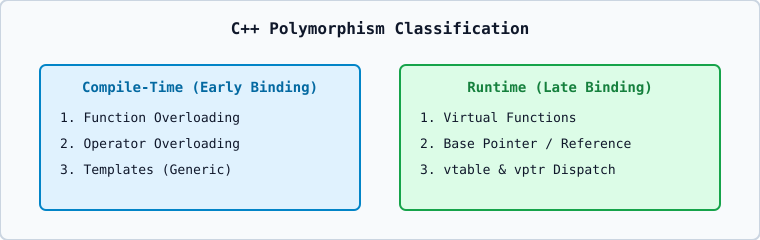

# 01 — Compile-Time vs. Runtime Polymorphism

## 1. Taxonomy of Polymorphism in C++
1. **Compile-Time Polymorphism (Static Binding / Early Binding)**:
   - Resolved by the compiler at compile time based on static types.
   - Achieved via **Function Overloading**, **Operator Overloading**, and **Templates**.
2. **Runtime Polymorphism (Dynamic Binding / Late Binding)**:
   - Resolved at runtime based on the actual dynamic type of the object pointed/referred to.
   - Achieved via **Inheritance + `virtual` Member Functions + Base Pointer or Base Reference**.
