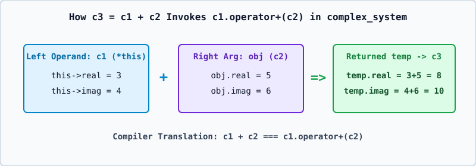

# 02 — Mandatory `complex_system` Example and Signed Integer Overflow Analysis



---

## 1. Classroom `complex_system` Implementation

Below is the clean, classroom-style `complex_system` program demonstrating constructor initialization, `Show_Num()`, `operator+()`, `c1 + c2`, and the explicit member call `c1.operator+(c2)`:

```cpp
#include <iostream>
using namespace std;

class complex_system {
private:
    int real;
    int imag;

public:
    complex_system(int r = 0, int i = 0) {
        real = r;
        imag = i;
    }

    complex_system operator+(const complex_system& obj) const {
        complex_system temp;
        temp.real = real + obj.real;
        temp.imag = imag + obj.imag;
        return temp;
    }

    void Show_Num() const {
        cout << real << " + " << imag << "i" << endl;
    }
};

int main() {
    complex_system c1(3, 4);
    complex_system c2(5, 6);

    // 1. Implicit operator expression syntax:
    complex_system c3 = c1 + c2;

    // 2. Explicit member function call syntax:
    complex_system c4 = c1.operator+(c2);

    c1.Show_Num();
    c2.Show_Num();
    c3.Show_Num();
    c4.Show_Num();

    return 0;
}
```

---

## 2. How `c1 + c2` Maps to `c1.operator+(c2)`

When the compiler encounters the binary expression:

```cpp
c3 = c1 + c2;
```

1. **Left Operand (`c1`)**: Becomes the implicit invoking object (`*this` pointer inside `operator+`). Inside `operator+`, bare `real` and `imag` refer to `c1.real` (`this->real`) and `c1.imag` (`this->imag`).
2. **Right Operand (`c2`)**: Is passed as the single explicit argument `obj` (`const complex_system& obj`).
3. **Result (`temp`)**: A brand-new `complex_system` object is constructed with `temp.real = c1.real + c2.real` and `temp.imag = c1.imag + c2.imag`, and returned **by value** so neither `c1` nor `c2` is modified!
4. **Why `c1 + c2` and `c1.operator+(c2)` are 100% Equivalent**: The C++ compiler literally rewrites `c1 + c2` into the member function call `c1.operator+(c2)`.

---

## 3. Critical Edge Cases: Signed Integer Overflow & Negating `INT_MIN`

When working with integer-based `complex_system` objects, two important C++ standard rules regarding **Signed Integer Overflow** (`[expr.pre]`) must be understood:

### A. Signed Integer Addition Overflow (`real + obj.real`) is Undefined Behavior
- In C++, **unsigned** integer arithmetic wraps around modulo $2^N$, which is well-defined.
- However, **signed** integer overflow (for example, adding `INT_MAX + 1`, where `INT_MAX` is `2147483647` on 32-bit `int`) is **Undefined Behavior (UB)**!
- Even in C++20 and C++23, where the standard guarantees that signed integers use **two's complement representation** (`[basic.fundamental]`), overflowing a signed `int` during arithmetic (`+`, `-`, `*`, unary `-`) remains **Undefined Behavior**.

### B. The `Show_Num()` Negative Imaginary Formatting Trap (`-imag` when `imag == INT_MIN`)
Suppose a student modifies `Show_Num()` to print negative imaginary numbers nicely as `3 - 4i` instead of `3 + -4i` by writing:

```cpp
// CAUTION: SUBTLE UNDEFINED BEHAVIOR ON INT_MIN!
void Show_Num_Unsafe() const {
    if (imag < 0) {
        cout << real << " - " << -imag << "i" << endl; // UB if imag == INT_MIN!
    } else {
        cout << real << " + " << imag << "i" << endl;
    }
}
```

#### Why is `-imag` Undefined Behavior when `imag == INT_MIN`?
In 32-bit two's complement representation:
- The minimum representable signed 32-bit `int` is `INT_MIN = -2147483648` ($-2^{31}$).
- The maximum representable signed 32-bit `int` is `INT_MAX = +2147483647` ($+2^{31} - 1$).
- Notice the asymmetry! $+2147483648$ **cannot be represented** in a 32-bit signed `int`!
- Therefore, if `imag == INT_MIN`, evaluating `-imag` (or `std::abs(INT_MIN)`) overflows the maximum positive signed `int` and triggers **Undefined Behavior**!

#### How to Format Negative Imaginary Components Safely in C++23
Either print `imag` directly (since `std::ostream::operator<<(int)` handles `INT_MIN` safely):
```cpp
void Show_Num() const {
    if (imag < 0) {
        cout << real << " - " << -(static_cast<long long>(imag)) << "i" << endl;
    } else {
        cout << real << " + " << imag << "i" << endl;
    }
}
```
Widening `imag` to a wider signed type (`long long`) or converting safely before negation avoids 32-bit `INT_MIN` negation UB.
