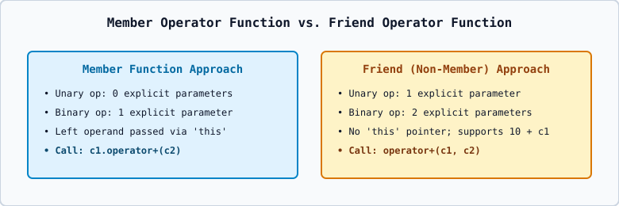

# 03 — Unary vs. Binary Overloading and Member vs. Friend Approach

---

## 1. Parameter Count Rules: Member Function vs. `friend` Function

Because a **non-static member function** always receives the left-hand (or sole) object implicitly via the hidden `this` pointer, it takes **one fewer explicit parameter** than a `friend` (non-member) function!

| Operator Type | Expression | Member Function Signature | `friend` (Non-Member) Signature |
| :--- | :--- | :--- | :--- |
| **Unary Generic (`-obj`)** | `-c1` | `complex_system operator-() const;` (**0** params) | `friend complex_system operator-(const complex_system& a);` (**1** param) |
| **Unary Prefix (`++obj`)** | `++c1` | `counter& operator++();` (**0** params) | `friend counter& operator++(counter& a);` (**1** param) |
| **Unary Postfix (`obj++`)** | `c1++` | `counter operator++(int);` (**1 dummy `int`**) | `friend counter operator++(counter& a, int);` (**2** params) |
| **Binary (`obj1 + obj2`)** | `c1 + c2` | `complex_system operator+(const complex_system& b) const;` (**1** param) | `friend complex_system operator+(const complex_system& a, const complex_system& b);` (**2** params) |

---

## 2. Distinguishing Prefix `++obj` from Postfix `obj++`

Both prefix and postfix increment use the exact same symbol `++`. How does the C++ compiler tell them apart?
- **Prefix (`++obj`)**: Declared with **no dummy parameter** (`counter& operator++()`). Increments the object first and returns `*this` by reference.
- **Postfix (`obj++`)**: Declared with an **unnamed dummy `int` parameter** (`counter operator++(int)`). Saves a copy of the old object, increments `*this`, and returns the saved old copy **by value**. When you write `obj++`, the compiler implicitly passes `0` as the dummy `int` argument (`obj.operator++(0)`).

---

## 3. When You MUST Use a `friend` (Non-Member) Function Over a Member Function

1. **When the Left-Hand Operand is a Built-In Type (`10 + c1`)**:
   - In `c1 + 10`, `c1` is on the left, so `c1.operator+(10)` works as a member function.
   - In `10 + c1`, the left operand is an `int` (`10`), and `int` is not a class (`10.operator+(c1)` is impossible!).
   - A `friend` function `friend complex_system operator+(int lhs, const complex_system& rhs)` takes both operands explicitly, allowing `10 + c1` to compile!
2. **Stream Insertion (`cout << c1`) and Extraction (`cin >> c1`)**:
   - In `cout << c1`, the left operand is `std::ostream` (`cout`), which belongs to the C++ Standard Library (`<iostream>`). Since we cannot add member functions inside `std::ostream`, `operator<<` and `operator>>` **must** be overloaded as non-member (typically `friend`) functions!
