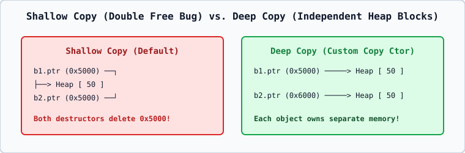

# 02 — Copy Constructor (`person(const person& other)`) and Shallow vs. Deep Copy

## 1. Why Must the Copy Constructor Parameter Be Passed by Reference?
If a copy constructor were declared by value as `person(person other)`, calling the copy constructor to pass `other` by value would require calling the copy constructor again to copy `other`, creating **infinite recursion**! Therefore, the C++ standard makes `person(person other)` a **compile-time error** (`[class.copy.ctor]`).

## 2. Shallow Copy vs. Deep Copy
- **Compiler-Generated Default Copy Constructor (Shallow Copy)**: Copies each member bit-by-bit/member-by-member. If a class owns a raw heap pointer `int* data`, both objects end up pointing to the **exact same heap block**, causing **Double Deletion UB** when both destructors run!
- **User-Defined Deep Copy Constructor**: Allocates a **separate new heap block** (`data = new int(*other.data);`) so each object owns independent memory.
