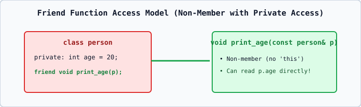

# 01 — Friend Functions: Syntax and Core Rules

## 1. Definition
A **`friend` function** of a class is a **non-member function** that is granted special permission by the class to access its `private` and `protected` members through an object of that class.

## 2. Key Rules of `friend` Functions
1. **Not in Class Scope**: A `friend` function is **not** a member function of the class, so it is not called with `obj.func()` and has **no `this` pointer**.
2. **Access Specifier Independence**: Placing `friend void show(const person& p);` inside `private:`, `protected:`, or `public:` has the exact same effect.
