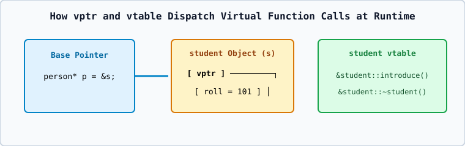

# 01 — How Virtual Functions Work Internally: `vtable` and `vptr`

## 1. The `vtable` and `vptr` Mechanism
When a class declares or inherits at least one `virtual` function:
1. **Per-Class Virtual Table (`vtable`)**: The compiler creates one static table of function pointers for that class containing the addresses of the most-derived `virtual` functions for that class.
2. **Per-Object Virtual Pointer (`vptr`)**: The compiler inserts a hidden pointer (`vptr`, 8 bytes on 64-bit systems) inside every object of that class, initialized by the constructor to point to that class's `vtable`.
3. **Runtime Lookup (`ptr->show()`)**: Follows `ptr->vptr` to the `vtable` and invokes the function pointer stored in the corresponding slot!
