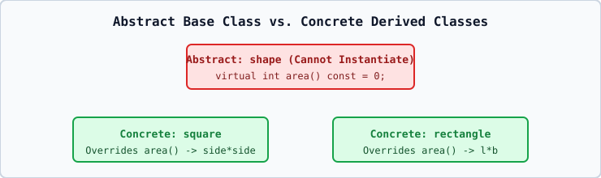

# 02 — Pure Virtual Functions (`= 0`) and Abstract Classes

## 1. Definitions
- **Pure Virtual Function**: A virtual function declared with `= 0` (`virtual void area() const = 0;`).
- **Abstract Class**: Any class containing **at least one** pure virtual function.

## 2. Strict Rules of Abstract Classes (`[class.abstract]`)
1. **Cannot Be Instantiated Directly**: Declaring `shape s;` is a **Compile-Time Error**.
2. **Pointers and References Are Allowed**: You **can** declare `shape* ptr;` and `shape& ref = circle_obj;`.
3. **Derived Class Rule**: If a derived class does **not** override all pure virtual functions of its base class, the derived class **also becomes abstract** and cannot be instantiated!
