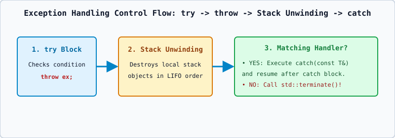

# 01 — Exception Handling Fundamentals: `try`, `throw`, and `catch`



---

## 1. Definition: What is an Exception?

An **exception** is a runtime anomaly or error condition (such as division by zero, out-of-bounds array index, failed memory allocation, or invalid user input) that prevents a function from completing its normal task.

### Errors vs. Exceptions
- **Compile-Time (Syntax/Semantic) Errors**: Detected by the compiler before the program runs (e.g., missing semicolon, access violation). Cannot be handled with `try`-`catch`.
- **Synchronous Runtime Exceptions**: Detectable runtime conditions raised explicitly via `throw` (or by standard library functions like `vector::at()` or `new`). **Handled by C++ `try`-`catch`.**
- **Hardware Traps / Undefined Behavior**: In C++, integer division by zero (`10 / 0`) or dereferencing `nullptr` (`*p`) at the CPU level does **NOT** automatically throw a C++ exception — it is Undefined Behavior! You must explicitly check `if (denom == 0) throw ...;` to raise a C++ exception.

---

## 2. The Three Keywords: `try`, `throw`, and `catch`

```cpp
try {
    // Protected block of code where an exception might occur
    if (b == 0) {
        throw "Division by zero error!"; // Transfers control immediately to catch
    }
    cout << (a / b) << endl;
}
catch (const char* msg) {
    // Exception handler that executes only if a matching type is thrown
    cout << "Caught exception: " << msg << endl;
}
```

### Strict Type-Matching Rules in `catch` (`[except.handle]`)
Unlike normal function calls, `catch` blocks do **NOT** perform implicit arithmetic conversions!
- Throwing an `int` (`throw 42;`) will **NOT** match `catch (double d)` or `catch (long l)`!
- Allowed conversions in `catch` are strictly limited to:
  1. Qualification conversions (e.g., `char*` matches `const char*`).
  2. Derived-to-Base conversions (e.g., throwing `std::runtime_error` matches `catch (const std::exception& e)`).
  3. Array-to-pointer decay (e.g., throwing `"error"` of type `const char[6]` matches `catch (const char*)`).

---

## 3. Multiple `catch` Blocks and Catch-All (`catch (...)`)

A single `try` block can be followed by multiple `catch` blocks tested **in top-to-bottom order**:

```cpp
try {
    // code
}
catch (int err_code) {
    cout << "Integer exception: " << err_code << endl;
}
catch (const char* msg) {
    cout << "String exception: " << msg << endl;
}
catch (...) {
    // Catch-all handler: catches ANY exception type not matched above
    cout << "Unknown exception caught!" << endl;
}
```

**Ordering Rule**: Always place **more specific (derived)** `catch` handlers **before** **more general (base)** `catch` handlers, and always place `catch (...)` **last**.
