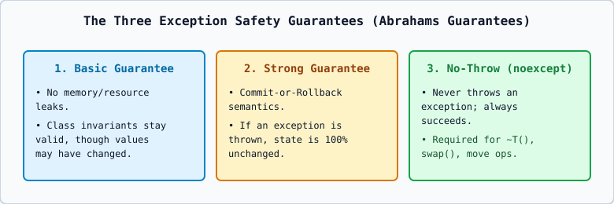

# 02 — Exception Propagation, Stack Unwinding, and Rethrowing (`throw;`)



---

## 1. Exception Propagation Across Function Calls

If a function `funcC()` executes a `throw` statement and does not have an enclosing `try`-`catch` block inside `funcC()`, the function immediately terminates its normal execution and **propagates** the exception up the call stack to its caller `funcB()`, and if unhandled there, up to `funcA()`, and finally to `main()`.

If the exception reaches the top of `main()` without finding any matching `catch` block anywhere in the call chain, the C++ runtime invokes **`std::terminate()`**, which aborts the program (`std::abort()`).

---

## 2. What is Stack Unwinding? (`[except.ctor]`)

**Stack Unwinding** is the automatic process performed by the C++ runtime as an exception propagates out of a `try` block or out of nested function stack frames on its way to a matching `catch` handler:

1. Every local automatic (stack) object that was **fully constructed** inside the exited scope is automatically **destroyed** by invoking its destructor (`~ClassName()`).
2. Destructors are called in **exact reverse order of construction** (Last-In, First-Out).
3. If a constructor itself throws an exception partway through constructing an object:
   - The destructors of any **already-constructed subobjects (base classes or data members)** are automatically called.
   - The destructor of the **partially constructed object itself is NOT called** (because its construction never completed).

---

## 3. Nested `try` Blocks and Rethrowing Exceptions (`throw;` vs `throw e;`)

Sometimes an inner `catch` block wants to log an error or perform partial cleanup and then pass the **exact same exception** up to an outer `catch` block:

```cpp
try {
    try {
        throw 404;
    }
    catch (int code) {
        cout << "Inner catch logged code: " << code << endl;
        throw; // RETHROW the current exception to the outer catch block!
    }
}
catch (int code) {
    cout << "Outer catch handled rethrown code: " << code << endl;
}
```

### Critical Distinction: `throw;` vs. `throw e;`
- **`throw;` (Empty throw inside a `catch` block)**: Rethrows the **original exception object** preserving its true dynamic polymorphic type without copying or slicing it. (Note: if `throw;` is executed when no exception is currently being handled, it immediately calls `std::terminate()`!)
- **`throw e;`**: Creates a **new copy** of `e` using its static type, which causes **object slicing** if `e` was caught as a base class `const std::exception&`! Always use `throw;` to rethrow.
