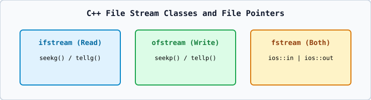

# 01 — File Stream Classes (`ofstream`, `ifstream`, `fstream`) and Opening Modes

1. **`std::ofstream`**: Output file stream (for writing to files; default mode `ios::out | ios::trunc`).
2. **`std::ifstream`**: Input file stream (for reading from files; default mode `ios::in`).
3. **`std::fstream`**: Bidirectional file stream (default mode `ios::in | ios::out`).

| Mode Flag | Meaning |
| :--- | :--- |
| `ios::in` | Open for reading |
| `ios::out` | Open for writing |
| `ios::app` | Append all writes to the end of the file |
| `ios::ate` | Move initial file position to the end upon opening |
| `ios::trunc` | Discard existing file contents if the file already exists |
| `ios::binary` | Open in binary mode (no newline character translation) |
