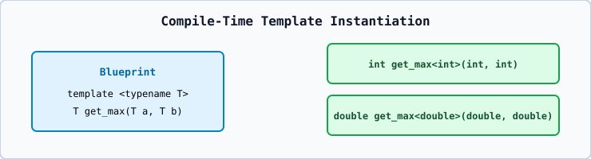

# 01 — Function Templates and Compile-Time Instantiation



```cpp
template <typename T>
T find_max(T a, T b) {
    return (a > b) ? a : b;
}
```
- `typename T` and `class T` inside `template <...>` are **100% interchangeable**.
- **Template Instantiation**: A template itself generates no machine code until called with concrete types (`find_max(10, 20)` instantiates `int find_max<int>(int, int)` at compile time).
- **Strict Type Deduction**: `find_max(10, 3.5)` fails to deduce `T` because the first argument is `int` and the second is `double`! Either pass matching types or specify explicitly: `find_max<double>(10, 3.5)`.
