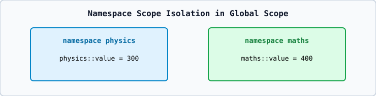

# 01 — Namespaces, `using` Declarations, and `using` Directives

- **Namespace Definition**: Groups identifiers (`classes`, `functions`, `constants`) into a named scope (`namespace math_dept { int code = 101; }`) to prevent global naming collisions.
- **Explicit Qualification**: `math_dept::code`
- **`using` Declaration**: `using math_dept::code;` imports only that single name.
- **`using` Directive**: `using namespace math_dept;` makes all names in `math_dept` visible.
