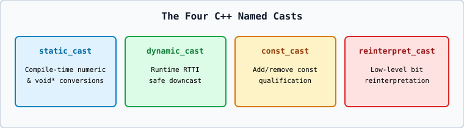

# 02 — The Four C++ Named Casts (`static_cast`, `dynamic_cast`, `const_cast`, `reinterpret_cast`)

| Named Cast | Primary Purpose | Checked When? |
| :--- | :--- | :--- |
| **`static_cast<T>(expr)`** | Well-defined numeric conversions (`double` to `int`), `void*` to `T*`, related class hierarchy casts | Compile time |
| **`dynamic_cast<T>(expr)`** | Safe runtime downcasting (`Base*` to `Derived*`) in polymorphic classes (requires `virtual` function in `Base`) | **Runtime (RTTI)** |
| **`const_cast<T>(expr)`** | Adding or removing `const`/`volatile` qualification | Compile time |
| **`reinterpret_cast<T>(expr)`** | Low-level bit/address reinterpretation between unrelated pointer types | Compile time |
