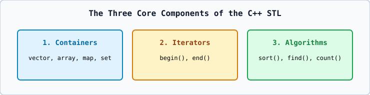

# 01 — STL Architecture and Sequence Containers (`std::vector`, `std::array`)

## 1. The Three Pillars of STL
1. **Containers**: Store collections of objects (`vector`, `array`, `list`, `map`, `set`).
2. **Iterators**: Generalized pointer-like objects (`begin()`, `end()`) that traverse containers.
3. **Algorithms**: Generic functions (`std::sort`, `std::find`, `std::reverse`) that operate on iterator ranges `[first, last)`.

## 2. `std::vector<T>`: `size()` vs. `capacity()` and `[]` vs. `.at()`
- `v.size()` is the current number of elements; `v.capacity()` is the total allocated heap slots before reallocation is needed.
- `v[i]` performs **no** bounds check (out-of-bounds is UB); `v.at(i)` performs bounds checking and throws `std::out_of_range` if `i >= v.size()`.
