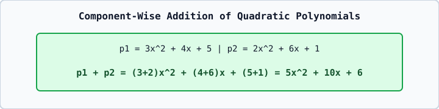

# 01 — Mathematical Computing Problem-Solving in C++23

In B.Tech Mathematics and Computing examinations, classic mathematical structures — **Quadratic Polynomials**, **Rational Fractions ($p/q$)**, **Complex Numbers ($a+bi$)**, and **Matrices** — are modeled as simple classes with constructors, `operator+`, `operator*`, and `display()` member functions.
