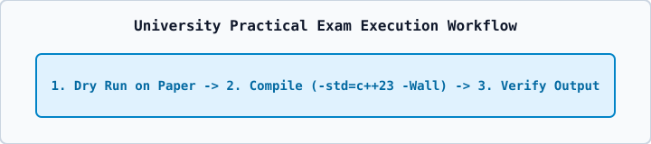

# 01 — University Lab Manual Index & Practical Exam Guidelines

1. Always compile lab programs with `g++ -std=c++23 -Wall -Wextra -Wpedantic file.cpp -o app`.
2. Write clean classroom class definitions (`person`, `student`, `complex_system`) with clear `private:`, `protected:`, and `public:` sections.
