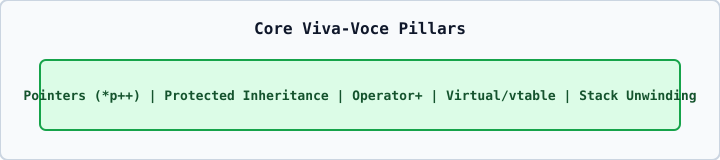

# 01 — Top 25 High-Frequency University Viva-Voce Questions & Concise Answers

1. **What is the difference between `*p++` and `(*p)++`?**
   `*p++` groups as `*(p++)`: it increments the pointer `p` and dereferences the old address. `(*p)++` increments the integer value stored at `*p` while leaving `p` unchanged.
2. **Why does `++*p` increment the value while `*++p` increments the pointer?**
   Unary `*` and prefix `++` share Precedence Level 3 and associate **Right-to-Left**: `++*p` is `++(*p)` (increments value), whereas `*++p` is `*(++p)` (increments pointer first, then dereferences).
3. **Why is `*p++ + *p++` Undefined Behavior?**
   Binary `+` does not sequence its left and right operands, causing unsequenced modifications to the scalar pointer `p`.
4. **In `class student : protected person`, why can `student::display()` call `input(30)` while `main()` cannot call `s.input(40)`?**
   `protected` inheritance turns `public` members of `person` into `protected` members of `student`. `protected` members are accessible **inside** `student`'s member functions (`display()`), but inaccessible **outside** in `main()`.
5. **Can a constructor be `virtual`?**
   No, because the object's `vptr` is set up by the constructor itself.
6. **Why should a base class destructor be `virtual`?**
   So that `delete base_ptr;` invokes the derived class destructor before the base class destructor, preventing resource leaks and Undefined Behavior.
7. **What is an abstract class?**
   A class with at least one pure virtual function (`virtual void f() = 0;`). It cannot be instantiated directly.
8. **Which C++ operators cannot be overloaded?**
   `::`, `.`, `.*`, `?:`, `sizeof`, `typeid`, `alignof`, `noexcept`.
9. **Which operators must be non-static member functions?**
   `=`, `[]`, `()`, `->`.
10. **Why must a copy constructor take its parameter by reference (`const T&`)?**
    Passing by value would call the copy constructor to copy the argument, causing infinite recursion.
11. **What is the Diamond Problem and how is it solved?**
    Ambiguous duplicate base subobjects in multipath inheritance; solved using `virtual public` inheritance.
12. **What is Stack Unwinding?**
    Automatic destruction (in reverse LIFO order) of all fully constructed local stack objects as an exception leaves a `try` block or function scope.
13. **What are the three Exception Safety Guarantees?**
    Basic (no leaks, valid invariants), Strong (commit-or-rollback, state unchanged on throw), and No-Throw (`noexcept`, never throws).
14. **Why is negating `INT_MIN` (`-imag` when `imag == INT_MIN`) Undefined Behavior?**
    In two's complement 32-bit `int`, `INT_MIN` is $-2^{31}$ (`-2147483648`) while `INT_MAX` is $2^{31}-1$ (`+2147483647`), so $-(\text{INT\_MIN})$ overflows signed `int`.
15. **What is the size of an empty class in C++?**
    At least `1` byte so distinct objects have distinct memory addresses.
