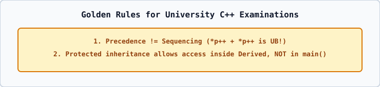

# 01 — Rapid Revision: The 13 Pointer Expressions & `const` Pointers

Given `int arr[3] = {10, 20, 30}; int* p = &arr[1];` (`*p` starts at `20`):

| Expression | Grouping | Result | Final `p` | Final `arr` |
| :--- | :--- | :---: | :---: | :--- |
| `*p++` | `*(p++)` | `20` | `&arr[2]` (`30`) | `{10, 20, 30}` |
| `(*p)++` | `(*p)++` | `20` | `&arr[1]` (`21`) | `{10, 21, 30}` |
| `++*p` / `++(*p)` | `++(*p)` | `21` | `&arr[1]` (`21`) | `{10, 21, 30}` |
| `*++p` / `*(++p)` | `*(++p)` | `30` | `&arr[2]` (`30`) | `{10, 20, 30}` |
| `*p--` | `*(p--)` | `20` | `&arr[0]` (`10`) | `{10, 20, 30}` |
| `(*p)--` | `(*p)--` | `20` | `&arr[1]` (`19`) | `{10, 19, 30}` |
| `--*p` | `--(*p)` | `19` | `&arr[1]` (`19`) | `{10, 19, 30}` |
| `*--p` | `*(--p)` | `10` | `&arr[0]` (`10`) | `{10, 20, 30}` |
| `*(p + 1)` | `*(p + 1)` | `30` | `&arr[1]` (`20`) | `{10, 20, 30}` |
| `*(p - 1)` | `*(p - 1)` | `10` | `&arr[1]` (`20`) | `{10, 20, 30}` |
| `*p + 1` | `(*p) + 1` | `21` | `&arr[1]` (`20`) | `{10, 20, 30}` |
